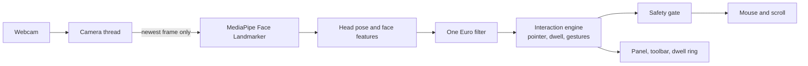

# Nodwell

[](https://github.com/KabirRao1/NodWell/actions/workflows/ci.yml)

**Hands-free computer control from an ordinary webcam.** Nodwell lets someone who can't
reliably use a mouse, keyboard, or their voice move the cursor with their head and click by
holding still or by a facial or head gesture. Everything runs on your own computer: camera
frames are processed in memory and never saved or sent anywhere.

> **Status: early development.** It works on Windows and is being tested hands-on. macOS and
> Linux builds are planned but not yet tested. Nodwell is an assistive tool, **not a medical
> device**, and makes no clinical claims.

## What it does

| You want to… | How |
|---|---|
| Move the cursor | Point your head at the screen (absolute mode), or tilt it like a joystick (relative mode) |
| Left click | Hold the cursor still for about a second. A ring around the cursor fills up, then it clicks |
| Right click, double click, drag, scroll | Pick it on the toolbar at the screen edge, then dwell. Or tilt your head right (right click) or left (double click) |
| Pause or resume | Raise your eyebrows and hold for 2 seconds, or use the panel |
| Recenter | Panel button. Nodwell also suggests it when your resting position drifts |
| Tune it | Live − and + controls for smoothness, how far you turn your head, and dwell time |

Caregiver keys work at any time:

| Key | Does |
|---|---|
| `Ctrl+Alt+P` | Stop everything instantly (press again to resume) |
| `Ctrl+Alt+R` | Recenter |
| `Ctrl+Alt+Q` | Quit |

**Safety:**
- If your face leaves the camera, the cursor freezes at once, and Nodwell pauses after 5 seconds.
- Clicks are rate limited.
- A held drag button is always released when Nodwell pauses, loses your face, or stops.
- If someone grabs the real mouse, Nodwell backs off.

**Accessibility:** every control is at least 64 px, reachable by keyboard, and labelled for
screen readers.

## Privacy

- **Nothing leaves the computer.** No accounts, no telemetry, no network calls. Camera frames
  stay in memory and are never written to disk.
- During a security audit we found that the face-tracking library, MediaPipe 1.0.1, sends
  usage analytics to Google from its native code. Nodwell therefore pins **MediaPipe 0.10.21**,
  which doesn't, and a test fails if a future version brings the uploader back. Details are
  in [docs/SECURITY_AUDIT.md](docs/SECURITY_AUDIT.md).
- The only files Nodwell keeps are its settings and a small log (start-up, warnings, and
  errors; never click positions).

## Getting started (from source)

You need [uv](https://docs.astral.sh/uv/) and a webcam. Python 3.12 is installed by uv.

```bash
git clone https://github.com/KabirRao1/NodWell.git
cd NodWell
uv sync                                   # install the exact locked dependencies
uv run python scripts/fetch_model.py      # download the face model and verify its checksum
uv run python -m nodwell                  # start Nodwell
```

Sit about an arm's length from the screen and look at it. Within a few seconds the status
changes to **Active**, and the cursor follows your head.

Useful options:

| Option | What it does |
|---|---|
| `--camera 1` | Use another camera, e.g. if camera 0 is an infrared camera |
| `--dry-run` | Track and show status, but never move or click |
| `--smoke-test` | Run the whole app on blank frames and exit 0 if everything works |

### Build the Windows app

```bash
uv run pyinstaller --noconfirm --clean packaging/nodwell.spec
dist\Nodwell\Nodwell.exe
```

The build is a folder, not a single file: copy the whole `dist\Nodwell` folder to move it to
another PC. It isn't code-signed yet, so Windows SmartScreen will show a warning.

## How it works



1. A camera thread keeps only the newest frame, so lag can't build up.
2. MediaPipe finds the face: 478 landmarks, facial-expression scores, and the head pose.
3. Nodwell turns these into head angles and gesture scores, and smooths them with a
   [One Euro filter](https://gery.casiez.net/1euro/).
4. A pure-Python state machine decides where the cursor goes and when to click. It contains
   no camera or UI code, so it is unit-tested from recorded numbers.
5. Every mouse action passes a safety gate that the panic key can close from any thread.
   A small thread glides the cursor between camera frames.

A full guided tour is in [docs/HOW_IT_WORKS.md](docs/HOW_IT_WORKS.md).

## Project layout

```
nodwell/
  core/        pure-Python logic: features, filters, pointer, dwell, gestures, engine, settings
  tracking/    camera capture and the MediaPipe wrapper
  platform/    mouse output, cursor glide, global hotkeys, Windows window styles
  ui/          status panel, click-type toolbar, dwell ring overlay, tray icon
  pipeline.py  the per-frame loop
bench/         latency benchmark
packaging/     PyInstaller spec for the Windows app
tests/         unit, scenario, fuzz, and security tests
spikes/        early experiments that de-risked the design
docs/          decisions, status, security audit, manual tests, metrics
```

## Development

```bash
uv run pytest            # tests, including fuzzing and security guards
uv run ruff check .      # lint
uv run ruff format .     # format
uv run mypy              # type check (strict on nodwell/core)
uv run python bench/latency.py --seconds 60   # per-stage latency report
```

CI runs lint, formatting, type checks, and tests on Windows, macOS, and Linux on every push.

## Limitations

- **Tested on Windows only so far.** macOS (Apple Silicon) and Linux (X11) are targets but
  haven't been tried on real hardware. Linux Wayland sessions are not supported.
- **Performance hasn't been measured yet.** Latency, frame rate on a mid-range laptop, and
  gesture accuracy will be reported in [docs/METRICS.md](docs/METRICS.md) once measured.
- **No calibration yet.** Gesture thresholds and head range use defaults until the
  calibration step lands.
- **Primary monitor only.**
- **Windows blocks input to administrator windows** (such as Task Manager) from normal apps,
  so Nodwell can't click inside them.
- **Webcam tracking quality varies** with lighting, glasses, and other factors.

## Roadmap

- **Done:** head pointer, dwell click, click-type toolbar, drag and scroll, head-tilt
  gestures, safety fail-safes, Windows build, security audit.
- **Next:** Control Center with onboarding and per-user calibration, profiles, themes, and a
  practice area.
- **Then:** an on-screen keyboard with word prediction, text-to-speech phrases, an attention
  alert, and switch scanning for people with a single reliable gesture. After that,
  installers for all three platforms.

## Documentation

| Document | What's in it |
|---|---|
| [HOW_IT_WORKS.md](docs/HOW_IT_WORKS.md) | Guided tour of the code |
| [DECISIONS.md](docs/DECISIONS.md) | Every significant design decision and why |
| [SECURITY_AUDIT.md](docs/SECURITY_AUDIT.md) | Security and privacy audit, findings, and fixes |
| [MANUAL_TESTS.md](docs/MANUAL_TESTS.md) | Step-by-step tests that need a real camera and screen |
| [STATUS.md](docs/STATUS.md) | What's done, in progress, and next |

## License

No license has been chosen yet, so all rights are reserved for now.

## Acknowledgements

Built on [MediaPipe](https://ai.google.dev/edge/mediapipe) face tracking,
[Qt for Python (PySide6)](https://doc.qt.io/qtforpython-6/),
[OpenCV](https://opencv.org/), and [pynput](https://github.com/moses-palmer/pynput).
